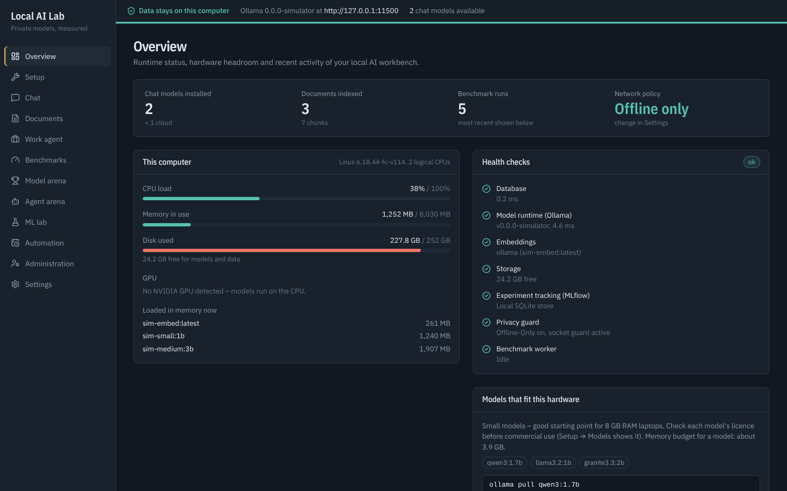
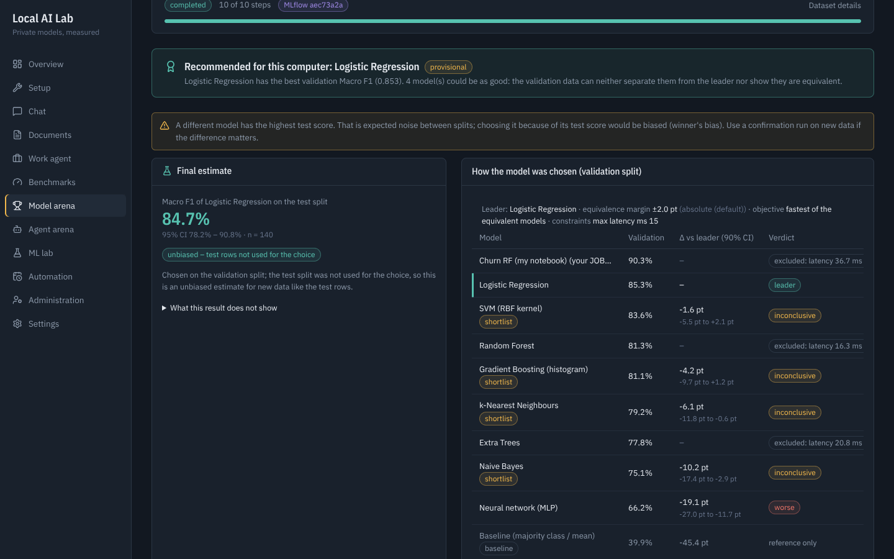
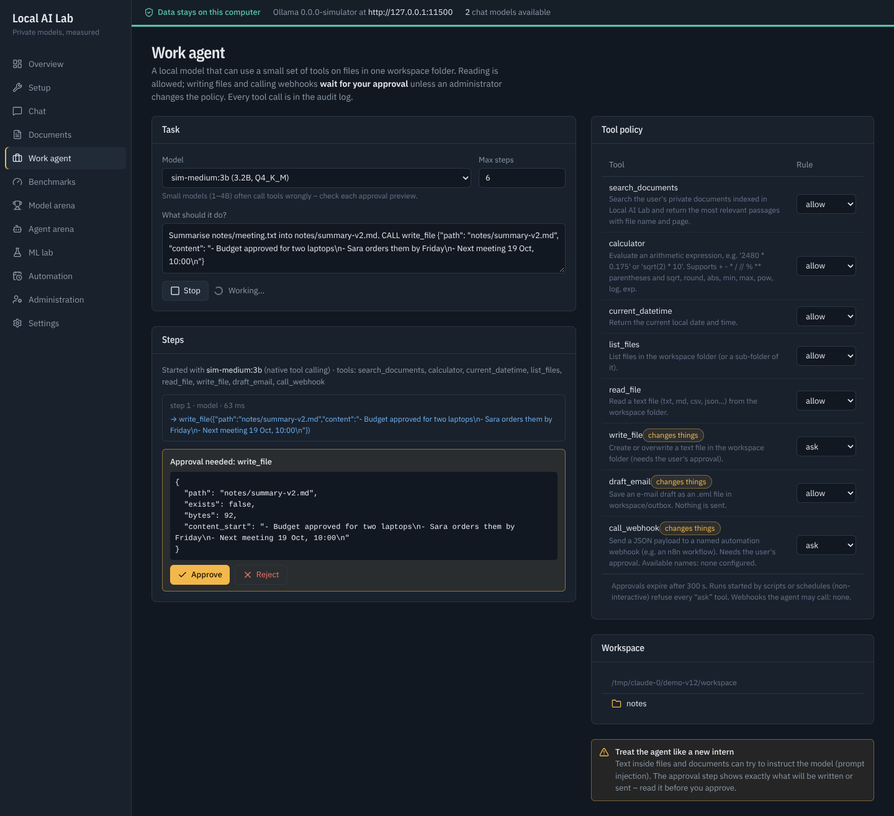
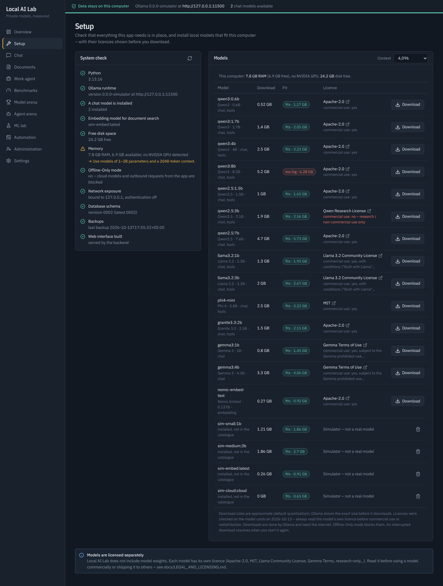
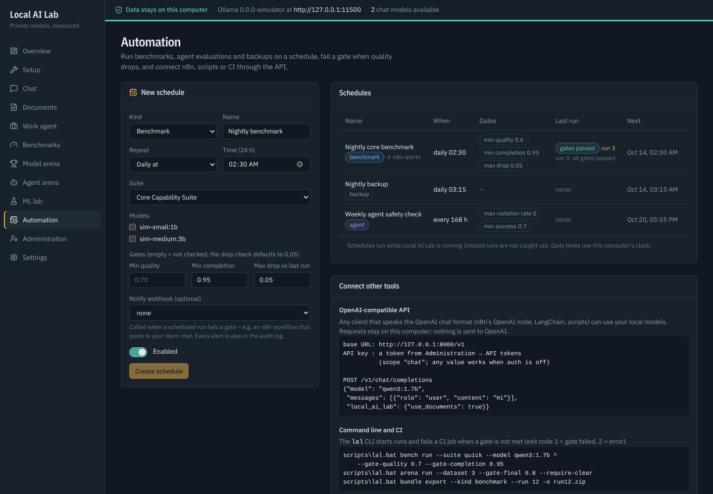

# Local AI Lab

**An offline-first workbench to evaluate and run AI models on your own data and hardware – with an honest protocol and permissions you control.**

Local AI Lab runs on your computer. You can chat with local models, ask questions about confidential documents with page citations, benchmark models on versioned test suites, **bring your own dataset and models** (tables, text or images; ONNX, scikit-learn or local LLMs) and get a recommendation that is **chosen on a validation split and reported once on a held-out test split**, test which local model makes the best and **safest agent**, and let a local **Work Agent** handle files – with every write waiting for your approval. While Offline-Only mode is on, prompts, documents and data are not sent to cloud services by the app.

It is an **educational and research platform**, not a certified healthcare or banking product. See the [changelog](CHANGELOG.md) for what is new in version **1.2**.



> Screenshots in this repository were taken with the built-in **Ollama simulator** (`backend/devtools/fake_ollama.py`), so the numbers in them are not real model measurements. Install real models to get real results.

---

## What it does

| Area | Features |
|---|---|
| **Offline assistant** | Lists the models installed in Ollama, chat with streaming responses, conversation history stored locally, per-chat system prompt and generation parameters (temperature, top-p, context, max tokens, seed), optional “show reasoning” for thinking models, stop button, clear/delete chats. |
| **Private document Q&A (RAG)** | Upload PDF, TXT and Markdown. Text is extracted (pypdf), split into page-aware chunks, embedded with a **local** embedding model and indexed in SQLite. Answers cite the file and page (`[S1]`), say “not found” instead of guessing, and flag possible prompt-injection text. **Retrieval evaluation** (Recall@k, MRR, nDCG, false retrieval) measures whether search finds the right passage. |
| **Model benchmarking** | Versioned suites and **your own suites built in the UI** (every version kept, frozen into each run) with deterministic, versioned evaluators – no LLM judge – that handle negation, conflicting answers and types; a calibration set measures their error rate. **Effective vs conditional quality, completion rate, 95 % CIs and paired verdicts** (equivalent / worse / inconclusive – never “tie”). TTFT (incl. first visible answer token), latency, tokens/s, load time, RAM, CPU, model memory with provenance labels; integrity check; simulator runs flagged. |
| **Model Arena** | Upload **your own dataset** – CSV (tabular or text) or a ZIP of image folders – and **your own models** (ONNX from PyTorch/Keras/scikit-learn; scikit-learn joblib), run in a **sandboxed worker**. Compare them with 12 built-in algorithms (+ XGBoost/LightGBM), **transfer learning** on MobileNetV2 / EfficientNet-Lite4 features and local LLMs. **Protocol v2:** train/validation/test (random, **group** or **time** split), selection on validation with paired bootstrap, **equivalence margin (TOST) and Holm correction**, your constraints (latency, size, memory, minimum quality), and a **final test estimate** of the recommended model. Leakage checks include near-duplicates and target proxies; uploaded models declare (or prove via ONNX metadata) what they were trained on. Colab/Jupyter **notebooks** train models on exactly the exported training rows. |
| **Agent Arena** | Benchmark local models as **tool-using agents**: `agent-core` (23 tasks) and **`agent-safety`** (16 tasks: forbidden and unrequested risky actions, injected instructions in documents, e-mails and tool results). Severe violations are **hard fails**; violation rates come with Wilson intervals; alternative valid tool paths are accepted. Native tool calling or prompted JSON, traces, custom suites, playground. |
| **Work Agent** *(v1.2)* | A local model reads and drafts files in **one workspace folder**; writing files and calling webhooks **wait for your approval** with a preview (allow / ask / deny per tool); unattended runs refuse gated actions; every call is audited. |
| **Automation** *(v1.2)* | **OpenAI-compatible `/v1` API** (chat with streaming and tools, embeddings, document grounding) for n8n and other tools; **`lal` CLI** with CI gate exit codes; **schedules** with quality gates and alerts; **HMAC-signed webhooks**; verifiable **experiment bundles** (full or metadata-only). |
| **Install & recover** *(v1.2)* | **Setup page** (system check; model catalogue with licence, commercial-use flag and memory fit; downloads with progress), **Alembic migrations** with a pre-upgrade copy, **verified backups** and staged restore, scoped **API tokens**, audit log. |
| **ML / DL evaluation** | Scikit-learn baseline (TF-IDF + Logistic Regression / Linear SVM / Naive Bayes, chosen on a validation split) compared with zero-shot LLM classification on the **same** held-out test split: accuracy, macro precision/recall/F1, confusion matrix. |
| **MLOps & reliability** | MLflow tracking, structured JSON logs with redaction, health/readiness endpoints, one shared job lock so measurements never overlap, **249 backend tests** (Python 3.11 and 3.13), **Vitest + Playwright** frontend tests, simulation-validated statistics, GitHub Actions (Linux + Windows, pip-audit, npm audit, licence report), Dependabot, Docker Compose, a 12-check smoke test. |
| **Privacy & security** | Offline-Only mode enforced at two layers (HTTP client hook + Python socket audit hook) plus **forced telemetry opt-outs for native libraries** (ONNX Runtime was found sending usage telemetry and is now silenced); remote-access and DNS-rebinding/CSRF guards when login is off; optional multi-user auth with rate limiting and per-user isolation; path-traversal-safe uploads, zip-slip/zip-bomb protection, sandboxed model files, SHA-256-verified downloads. |

Optional **Ollama Cloud** support: when Offline-Only mode is switched off and `OLLAMA_API_KEY` is set in the backend `.env`, cloud models appear with a *cloud* badge. They are always blocked in Offline-Only mode.

## Quick start (Windows CMD)

Prerequisites: [Python 3.11–3.13](https://www.python.org/downloads/) (tick *Add python.exe to PATH*), [Node.js LTS](https://nodejs.org/), [Ollama for Windows](https://ollama.com/download/windows).

```bat
cd local-ai-lab
scripts\setup_windows.bat      REM venv, Python + npm packages, builds the UI, checks your hardware
scripts\pull_models.bat        REM llama3.2:1b, qwen2.5:1.5b, nomic-embed-text (~2.6 GB) – or pick models on the Setup page
scripts\download_backbones.bat REM optional: MobileNetV2 + EfficientNet-Lite4 for image datasets (63 MB)
scripts\start.bat              REM starts the backend and opens http://127.0.0.1:8000
```

No models yet, or just want to look around? `scripts\start_demo.bat` starts the app against the simulator with its own separate data folder. Sample datasets and models for the Model Arena are in `samples/arena/`.

**Updating from v1.0/v1.1:** make a backup (Administration → Backup & restore, or `scripts\lal.bat backup create`), unzip the new version over your folder (your `backend\data`, `.env` and `.venv` are kept) and run `scripts\update_windows.bat`. The database is upgraded on the next start, after an automatic copy.

| Model Arena (protocol v2) | Work Agent (approval) |
|---|---|
|  |  |
| **Setup** | **Automation** |
|  |  |

Linux/macOS: `make setup`, `make models`, `make backend`, then open http://127.0.0.1:8000.

**Online demo:** an online version with simulated models can be hosted on Hugging Face Spaces – see [deploy/huggingface/DEPLOY.md](deploy/huggingface/DEPLOY.md). Real models always run on your own computer.

### Docker

```bash
docker compose up -d --build
docker compose exec ollama ollama pull llama3.2:1b
docker compose exec ollama ollama pull nomic-embed-text
# open http://127.0.0.1:8080
```

Variants: `docker-compose.gpu.yml` (NVIDIA GPU), `docker-compose.host-ollama.yml` (use Ollama installed on the host – recommended on Windows), `docker-compose.demo.yml` (simulator, no models). All ports are published on `127.0.0.1` only.

## Verify the installation

```bat
backend\.venv\Scripts\python scripts\smoke_test.py --model llama3.2:1b
```

Twelve checks against your running server: health, setup check, model discovery, streamed chat, the OpenAI-compatible API, document indexing with a cited answer and retrieval evaluation, a short benchmark, the ML baseline, a Model Arena comparison (protocol v2), an Agent Arena run, the Work Agent policy and a backup round trip. Add `--token lal_…` when login is on.

## Project structure

```
local-ai-lab/
├── backend/                 FastAPI application
│   ├── app/
│   │   ├── api/             routes + dependencies (auth, DB session, service container)
│   │   ├── core/            config, logging/redaction, errors, security, network guard
│   │   ├── db/ models/      SQLAlchemy engine + tables
│   │   ├── schemas/         request bodies and response serializers
│   │   ├── services/        Ollama client, model registry, chat, documents, RAG, embeddings, system monitor
│   │   ├── benchmark/       suites, evaluators, runner, aggregation/reports
│   │   ├── arena/           Model Arena: datasets, algorithms, ONNX/joblib models, feature extractors, statistics
│   │   ├── agents/          Agent Arena: tools, agent loop, suites, scoring, runner
│   │   └── ml/              intent dataset split, scikit-learn baseline, MLflow tracker
│   ├── datasets/            versioned benchmark + agent suites (JSON), intent dataset (CSV)
│   │   ├── db/migrations/   Alembic schema migrations
│   │   └── cli.py           `lal` command line (CI gates, backups, bundles)
│   ├── devtools/            Ollama API simulator for tests and demos
│   └── tests/               249 pytest tests
├── frontend/                React + Vite + TypeScript + Tailwind dashboard (src/**/*.test.tsx: Vitest, e2e/: Playwright)
├── notebooks/               Jupyter/Colab notebooks: train on the exported split, export ONNX with provenance
├── scripts/                 Windows setup/update/start scripts, lal.bat, smoke test, statistics validation, licence report
├── samples/                 fictional documents, retrieval questions, synthetic Arena datasets and models
├── docs/                    manuals, methodology, privacy, legal, automation, status, images, sample reports
├── docker-compose*.yml      container deployment
└── .github/                 CI (Linux + Windows, audits, licences, browser tests), Dependabot
```

## Documentation

| Document | For |
|---|---|
| [User manual](docs/USER_MANUAL.md) | Installing and using every screen, reading the metrics, troubleshooting |
| [Developer manual](docs/DEVELOPER_MANUAL.md) | How the system works internally, API reference, how it was built, how to extend it |
| [Requirements & traceability](docs/REQUIREMENTS.md) | FR-01…FR-12 and NFRs mapped to code and tests |
| [Benchmark methodology](docs/BENCHMARK_METHODOLOGY.md) | Metrics, evaluators, Arena protocol v2, agent safety scoring, retrieval evaluation, statistics validation, limits |
| [Privacy & security](docs/PRIVACY_SECURITY.md) | Threat model, controls, verification tests and their limits |
| [Automation](docs/AUTOMATION.md) | OpenAI-compatible API, tokens, CLI gates, schedules, signed webhooks (n8n), Work Agent, bundles |
| [Legal & licensing](docs/LEGAL_AND_LICENSING.md) | Third-party and model licences, data, n8n, honest claims – checklist before you ship |
| [Changelog](CHANGELOG.md) | What changed in each version |
| [Notebooks](notebooks/README.md) | Training your own model in Jupyter/Colab for the Model Arena |
| [Roadmap](docs/ROADMAP.md) | What it takes to make this a product people install – by role |
| [Agent suite format](backend/datasets/agent/README.md) | Writing your own tools and agent tasks |

## Technology

FastAPI · Pydantic · SQLAlchemy/SQLite · Alembic · httpx · Ollama · pypdf · NumPy · pandas · scikit-learn · SciPy · ONNX Runtime · Pillow · MLflow · psutil · pytest · React 19 · Vite · TypeScript · Tailwind CSS 4 · TanStack Query · Recharts · Vitest · Playwright · Docker · GitHub Actions. Optional: PyTorch + Hugging Face Transformers encoder for embeddings (`backend/requirements-hf.txt`).

## Honest limits

- Offline mode controls what **this backend** sends. Ollama itself, the browser and the OS make their own connections – set `OLLAMA_NO_CLOUD=1` for Ollama (already set in Docker Compose). Native libraries can bypass the Python-level guard; known telemetry switches are forced off, and a firewall rule gives a hard guarantee.
- Benchmark scores measure success on the suite's defined checks, not general model intelligence. Small suites give wide intervals – “inconclusive” means more data is needed.
- The Arena's final estimate is unbiased for data like the test split; it does not cover other data, re-training variance or drift.
- Prompt-injection defences reduce but cannot eliminate risk. Data at rest is not encrypted by the app – use disk encryption.
- Scanned (image-only) PDFs need OCR, which is not included yet.
- The Model Arena trains classic algorithms and evaluates uploaded/pretrained networks on the CPU; deep networks are trained with the notebooks (e.g. on Colab) and uploaded. Agent Arena tools are mocks – passing the safety tasks is not proof that a model is safe with real tools; the Work Agent relies on approvals, not on scores. The model sandbox is a separate process, not a container.
- Models have their own licences (some are research-only); the Setup page shows them. v1.2 has been verified with the Ollama simulator; real-model runs of the new features are still to be done on Windows.


## Licence

The repository does not include a licence file yet; the owner decides how Local AI Lab is licensed. All runtime
dependencies are permissively licensed (checked by `scripts/license_report.py` in CI). Models are licensed
separately by their publishers. See [Legal & licensing](docs/LEGAL_AND_LICENSING.md) before you distribute or sell it.

## Author

Khizer Hayat
