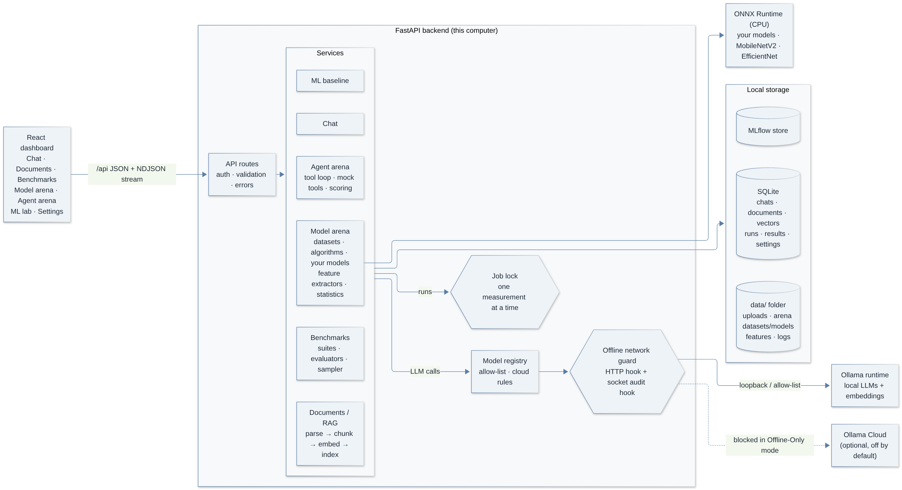
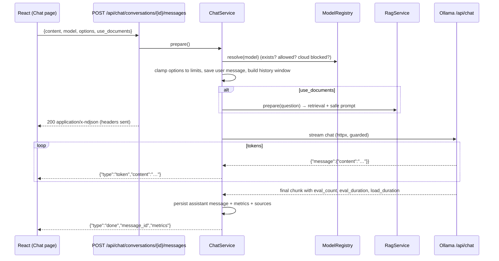
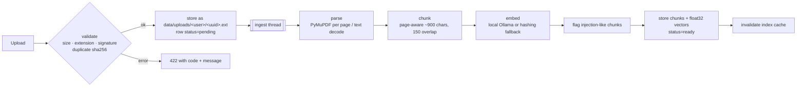
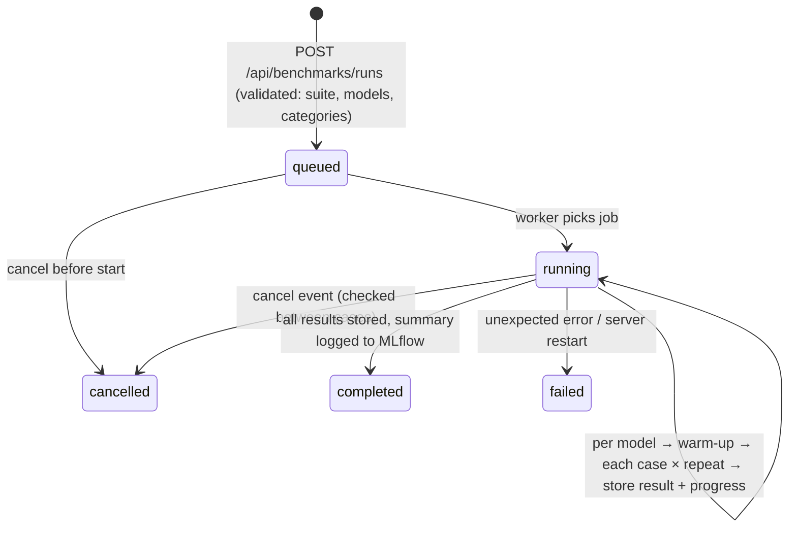
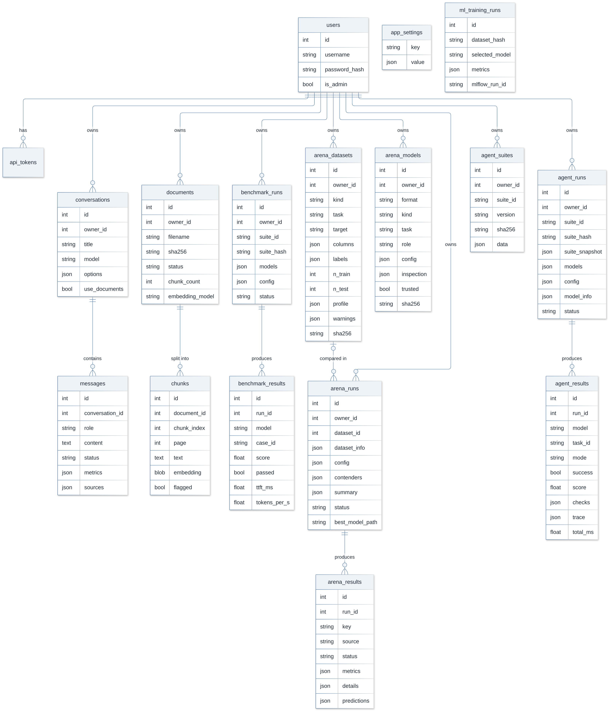
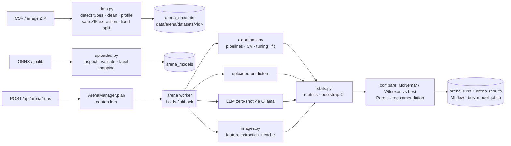
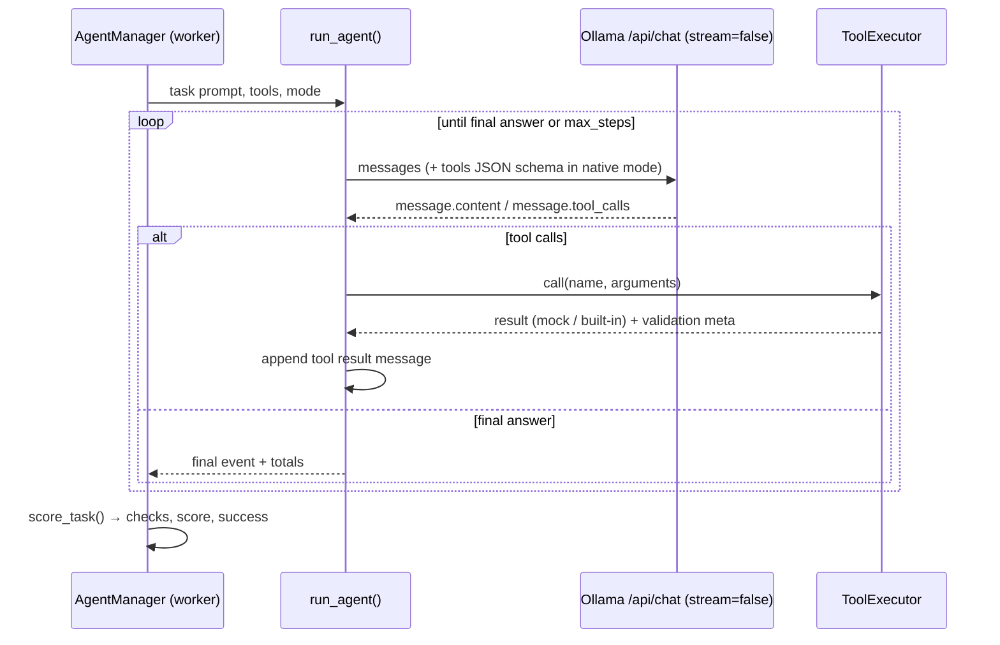

# Local AI Lab – Developer Manual

This manual explains **how Local AI Lab works internally** and **how it was built**, so that a developer (or examiner) can understand, run, test, extend and defend every part of it. Read the [User manual](USER_MANUAL.md) first if you have not used the app.

---

## Contents

1. [System overview](#1-system-overview)
2. [Technology choices](#2-technology-choices)
3. [Repository layout](#3-repository-layout)
4. [Development setup](#4-development-setup)
5. [How a request flows through the system](#5-how-a-request-flows-through-the-system)
6. [Backend module reference](#6-backend-module-reference)
7. [Data model and database initialisation](#7-data-model-and-database-initialisation)
8. [API reference](#8-api-reference)
9. [Configuration reference](#9-configuration-reference)
10. [Privacy and security implementation](#10-privacy-and-security-implementation)
11. [Benchmark engine internals](#11-benchmark-engine-internals)
12. [ML baseline internals](#12-ml-baseline-internals)
13. [Model Arena internals](#13-model-arena-internals)
14. [Agent Arena internals](#14-agent-arena-internals)
15. [Frontend architecture](#15-frontend-architecture)
16. [Testing](#16-testing)
17. [MLOps: tracking, CI and containers](#17-mlops-tracking-ci-and-containers)
18. [Extending the system](#18-extending-the-system)
19. [How this project was built](#19-how-this-project-was-built)
20. [Known limitations and future work](#20-known-limitations-and-future-work)
21. [Conventions](#21-conventions)
22. [Version 1.2 internals](#22-version-12-internals) – migrations, backups, Arena protocol v2, sandbox, tokens and guards, Work Agent, automation, bundles

---

## 1. System overview



Local AI Lab is a **two-tier web application** plus an external model runtime:

| Tier | Technology | Responsibility |
|---|---|---|
| Frontend | React 19 + Vite + TypeScript + Tailwind | Dashboard UI. Talks only to its own origin under `/api`. |
| Backend | FastAPI (Python) | Business logic, persistence, streaming, security, benchmarking, ML, Model Arena, Agent Arena. |
| Runtime | Ollama (separate process/container) | Loads models and performs LLM inference and embeddings. |
| Storage | SQLite + `data/` folder | Conversations, documents, vectors, runs, settings; files, logs, ML artifacts, MLflow store. |

Design principles:

1. **Local by default.** The only network peer of the backend is the local Ollama runtime. Everything else is blocked in Offline-Only mode (two independent layers, see §10).
2. **Measured, not claimed.** Every number in the UI comes from the database; each metric is labelled with its provenance (measured by the app, reported by the runtime, or estimated).
3. **Deterministic evaluation.** Benchmarks use rule-based evaluators, versioned datasets and dataset hashes – no LLM-as-judge.
4. **Thin routes, testable services.** Routes validate input and call services; services hold logic and are unit/integration tested against a real HTTP simulator of Ollama.
5. **Graceful degradation.** If Ollama is down, the embedding model is missing or MLflow is not installed, the app keeps working and explains what is missing.

## 2. Technology choices

| Decision | Choice | Why | Alternatives considered |
|---|---|---|---|
| API framework | FastAPI + Pydantic v2 | typed validation, OpenAPI docs at `/docs`, simple streaming | Flask (no typing/validation built in) |
| Model runtime | Ollama HTTP API | one-command model download, CPU/GPU support, quantized GGUF models, Windows installer | llama.cpp server (more manual), HF Transformers inference (heavy on CPU) |
| HTTP client | `httpx` (sync) | streaming, timeouts, event hooks used by the offline guard | `requests` (no event hooks for guarding) |
| Concurrency | sync services + threads | Starlette runs sync generators in a threadpool, so streaming works without async complexity; benchmark worker is a dedicated thread | full asyncio (harder to test, little benefit for one local user) |
| Database | SQLite (WAL) via SQLAlchemy 2 | zero setup, one file, enough for local use | PostgreSQL (planned for multi-user scale) |
| Vector index | float32 vectors in SQLite + NumPy cosine search, cached per user | no extra service, exact search, fast for thousands of chunks | FAISS/Chroma (extra dependency, Chroma adds telemetry) |
| Embeddings | Ollama `nomic-embed-text`; lexical hashing fallback; optional HF encoder | local, small, multilingual options; fallback needs no download | sentence-transformers (needs PyTorch) |
| PDF parsing | PyMuPDF | fast, page-accurate text, detects encryption | pdfminer (slower) |
| Classic ML | scikit-learn | standard, CPU-friendly, interpretable | – |
| Running user models | ONNX Runtime (CPU) | one runtime for PyTorch, Keras/TF and scikit-learn exports; no code execution; ~15 MB | loading TF/PyTorch natively (hundreds of MB, pickle risks) |
| Image transfer learning | ONNX Model Zoo MobileNetV2 / EfficientNet-Lite4 as feature extractors | strong features on a CPU without training a network | fine-tuning CNNs (needs a GPU) |
| Agent tool calling | Ollama native `tools` + prompted-JSON fallback | compares every local model, with and without tool support | framework-specific agents (LangChain etc. hide what is measured) |
| Tracking | MLflow with local SQLite store | standard experiment tracking, no server needed | Weights & Biases (cloud) |
| Frontend data | TanStack Query | caching, polling and invalidation for live run progress | hand-written fetch hooks |
| Charts | Recharts | declarative React charts | Chart.js |

## 3. Repository layout

```
backend/
  app/
    main.py                 app factory: build_context() wires all services; middleware, error handlers, SPA serving
    core/
      config.py             Settings (env/.env) – static configuration
      logging.py            JSON logs, RedactionFilter (masks secrets, truncates content)
      errors.py             AppError hierarchy → {"error": {code, message, hint}}
      security.py           scrypt password hashing, API tokens, safe_join, sanitize_filename
      network_guard.py      Offline-Only enforcement (HTTP hook + socket audit hook)
      jobs.py               JobLock – benchmark, arena and agent runs never measure at the same time
    db/                     engine/session factory, init_db(), SCHEMA_VERSION
    models/                 SQLAlchemy tables (core, chat, document, benchmark, ml, arena, agents)
    schemas/                request bodies; serializers for responses
    api/
      deps.py               AppContext (service container), get_db, current_user, require_admin
      routes/               health, auth, system, models, chat, documents, benchmarks, ml, arena, agents, settings
    services/
      ollama_client.py      HTTP client for Ollama; maps errors to readable AppErrors
      model_registry.py     discovery, capabilities, cloud detection, allow-list, resolve()
      settings_service.py   runtime settings stored in DB (Settings screen)
      inference.py          stream_generate(): tokens + measured/runtime metrics; option clamping
      chat_service.py       conversations, history window, NDJSON event stream, persistence
      document_parser.py    file-type validation (extension + signature), PDF/TXT/MD extraction
      chunker.py            page-aware chunking with overlap
      embeddings.py         OllamaEmbedder, HashingEmbedder, HFEmbedder (optional)
      document_service.py   upload → background ingestion → index cache → retrieval
      prompt_safety.py      injection detection, neutralisation, RAG prompt construction
      rag_service.py        grounded-answer preparation, cloud/document policy
      system_monitor.py     hardware snapshot, GPU detection, recommendations, ResourceSampler
    benchmark/
      datasets.py           suite schema/validation, SuiteRepository (+ generated intent suite)
      evaluators.py         14 deterministic evaluators
      runner.py             BenchmarkManager: queue, worker thread, warm-up, cancellation, tracking
      aggregate.py          per-model summaries, percentiles, CSV/Markdown export
    ml/
      intent_data.py        versioned intent dataset + deterministic stratified split
      intent_baseline.py    candidate pipelines, model selection, test metrics, predictor
      tracking.py           MLflow Tracker (lazy, local, never raises)
    arena/                  Model Arena (§13)
      data.py               CSV/ZIP ingestion, type detection, cleaning, profile, safe extraction, split
      service.py            ArenaStore: dataset/model files + rows, load(), take()
      algorithms.py         built-in algorithm catalog and kind-specific pipelines
      images.py             preprocessing, ONNX sessions, feature extraction, backbone catalog/download
      uploaded.py           upload inspection, label mapping, ONNX/joblib predictors
      stats.py              metrics, bootstrap CIs, McNemar/Wilcoxon, Pareto, recommendation
      runner.py             ArenaManager: plan, worker, contenders, persistence, MLflow
      report.py             serializers, CSV/Markdown reports
    agents/                 Agent Arena (§14)
      tools.py              ToolSpec, matchers, schema validation, safe built-in tools, ToolExecutor
      suites.py             suite/task/expect schema, AgentSuiteRepository (built-in + per-user)
      loop.py               run_agent(): native and prompted tool calling, trace events
      scoring.py            per-task checks and score
      runner.py             AgentManager: queue, worker, fallback, persistence, MLflow
      report.py             summaries, CSV/Markdown reports
  datasets/benchmark/*.json versioned benchmark suites
  datasets/agent/*.json     versioned agent suites (agent-core 23 tasks, agent-quick 6) + README (format)
  datasets/intent/*.csv     intent dataset
  devtools/fake_ollama.py   Ollama API simulator (tests, demo, CI)
  tests/                    pytest suite
frontend/src/
  main.tsx, App.tsx         providers, routing, auth gate, lazy-loaded pages
  api/client.ts             fetch wrapper, ApiError, NDJSON stream reader, downloads
  api/types.ts              TypeScript types mirroring API responses
  api/arena.ts, agents.ts   types for the two arenas
  components/               Layout (sidebar + data-boundary strip), ui kit, ModelSelect, Markdown, Sources,
                            Tabs (URL-synced), ConfusionMatrix, TraceView (agent steps)
  pages/                    Overview, Chat, Documents, Benchmarks, RunDetail, MLLab, ModelArena, ArenaRunDetail,
                            AgentArena, AgentRunDetail, Settings, Login
samples/arena/              synthetic CSVs, image ZIP and ONNX model to try the Model Arena
scripts/                    setup/update/start scripts, download_backbones, make_arena_samples, smoke_test
  lib/                      formatting helpers, shared queries
```

## 4. Development setup

```bash
# backend
cd backend
python -m venv .venv
.venv/Scripts/activate            # Windows (Linux/macOS: source .venv/bin/activate)
pip install -r requirements-dev.txt
uvicorn app.main:app --reload --host 127.0.0.1 --port 8000
# interactive API docs: http://127.0.0.1:8000/docs

# frontend (hot reload, proxies /api to :8000)
cd frontend
npm install
npm run dev                        # http://127.0.0.1:5173
```

Without Ollama models, run the simulator and point the backend at it:

```bash
cd backend
python -m devtools.fake_ollama --port 11500 --speed 0.5
OLLAMA_BASE_URL=http://127.0.0.1:11500 EMBEDDING_MODEL=sim-embed DEFAULT_MODEL=sim-small:1b uvicorn app.main:app
```

`requirements.lock.txt` lists the exact versions the test suite passed with.

## 5. How a request flows through the system

### 5.1 Startup

`create_app()` → `configure_logging()` → `build_context()`:

1. `settings.ensure_dirs()` creates `data/uploads`, `logs`, `ml`, `reports`.
2. `apply_pending_restore()` applies a staged backup restore (if any) **before** the database is opened. SQLite engine (WAL, foreign keys) → `init_db()` runs the Alembic migrations (with a copy of the database first when an upgrade is needed) and ensures the built-in `local` user.
3. `SettingsService.get()` loads runtime settings from the DB and configures the network guard (offline mode, allow-list). The socket audit hook is installed once per process.
4. Clients and services are created and stored in `AppContext` on `app.state.ctx`.
5. The lifespan handler starts three worker threads (benchmarks, Model Arena, Agent Arena) and the schedule manager, and marks runs left `running` by a previous crash as `failed`. All three workers share one `JobLock`, so only one measurement job runs at a time; the others stay `queued`.
6. Middleware order: request logging → `browser_guard` (Host/Origin checks when auth is off) → remote-access guard (`UNAUTHENTICATED_NETWORKS`) → routes.

### 5.2 A streamed chat turn



Key points:

- **Validation happens before streaming starts** (`prepare()`), so problems such as an unknown model return a normal HTTP error (404/403/503) with a hint instead of a broken stream.
- Errors during generation are sent as an `error` event; partial text is saved with `status="partial"`.
- If the client disconnects (Stop button), the generator receives `GeneratorExit` and saves the partial answer.
- History is trimmed from the oldest message to fit `num_ctx − num_predict` (token estimate = characters/4). Reasoning blocks (`<think>…</think>`) are removed from history.

**NDJSON event protocol** (one JSON object per line):

| type | fields |
|---|---|
| `start` | `conversation_id`, `user_message_id`, `model`, `provider` |
| `sources` | `sources[]` (n, document_id, filename, page, chunk_index, score, flagged, snippet), `warnings[]`, `retrieval` |
| `thinking` | `content` (reasoning tokens, only when requested) |
| `token` | `content` |
| `done` | `message_id`, `status`, `metrics` {ttft_ms, total_ms, load_ms, prompt_tokens, output_tokens, tokens_per_s, tokens_source, done_reason} |
| `error` | `code`, `message`, `hint` |

### 5.3 Document ingestion



- The stored file name is a UUID; the user's file name is sanitised and used only for display, so path traversal is impossible (`safe_join` double-checks).
- Ingestion runs on a single background thread (`DOC_PROCESSING_MODE=background`); tests use `inline`.
- Each document remembers its `embedding_backend` and `embedding_model`. Retrieval only compares a query with chunks embedded by the **same** model; others are reported as “re-index needed”.
- Scanned PDFs (no text), encrypted PDFs and malformed files end in `status=failed` with a readable error.

### 5.4 Retrieval and grounded answers

1. `DocumentService.retrieve(owner_id, question)` loads (and caches) a matrix of the owner's ready chunk vectors for the current embedder, optionally filtered to selected documents.
2. Query embedding · matrix → cosine scores (vectors are L2-normalised). Top-k above `rag_min_score` (default 0.30 neural, 0.08 lexical) are returned.
3. `RagService.prepare()` enforces the cloud policy (documents never go to cloud models unless allowed), builds warnings (fallback embedder, stale documents, flagged chunks) and the prompt:
   - system: `RAG_SYSTEM_POLICY` (treat excerpts as untrusted data, cite `[S#]`, exact “not found” sentence) + user style preferences;
   - user: excerpts inside a random delimiter `<<<DOC_CONTEXT_A1B2C3D4>>> … <<<END_DOC_CONTEXT_A1B2C3D4>>>`, each labelled `[S1] (file, page n)`, then the question.
4. If nothing passes the threshold, the model is **not called**; the fixed answer “I could not find this in the indexed documents.” is returned.

### 5.5 Benchmark run lifecycle



See §11 for what is measured per case.

### 5.6 ML baseline

`POST /api/ml/baseline/train` → `train_and_evaluate()` (≈1 s) → MLflow run → `ml_training_runs` row. `GET /api/ml/comparison` recomputes classification metrics for every completed `intent-classification` benchmark run from the stored `eval_details.details.predicted` labels, using the same function as the baseline. See §12.

## 6. Backend module reference

| Module | Key items | Notes |
|---|---|---|
| `core/config.py` | `Settings`, `get_settings()` | Reads `.env` in repo root and `backend/`. List values accept `a,b,c` or JSON (`NoDecode`). |
| `core/network_guard.py` | `NetworkGuard`, `guard`, `guarded_http_client()`, `OfflineNetworkBlocked` | §10. |
| `core/logging.py` | `configure_logging`, `RedactionFilter`, `JsonFormatter`, `redact()` | Messages > 500 chars are truncated; bearer tokens, `api_key=`, `password=` masked. |
| `core/security.py` | `hash_password` (scrypt n=2¹⁴), `verify_password`, `new_token`, `hash_token` (SHA-256), `safe_join`, `sanitize_filename` | Tokens are stored hashed. |
| `services/ollama_client.py` | `OllamaClient.version/tags/ps/show/embed/chat_stream` | Translates `ConnectError→RuntimeUnavailable(503)`, read timeout→`InferenceTimeout(504)`, 404→`ModelNotAvailable` with `ollama pull` hint, memory errors→`InsufficientResources(507)`. |
| `services/model_registry.py` | `ModelRegistry.list_models()`, `.resolve()`, `is_cloud_tag()`, `CLOUD_PREFIX="cloud::"` | Capabilities from `/api/show` (cached per digest); fallback name heuristics for embedding models. Cloud = `:cloud`/`-cloud` tags, `remote_host` field, or `cloud::` prefix (Ollama Cloud API). |
| `services/inference.py` | `stream_generate()`, `GenerationResult`, `clamp_options()`, `strip_think()` | Single place where TTFT/latency are measured and runtime metrics parsed. |
| `services/chat_service.py` | `ChatService.prepare/stream`, `run_stream()`, `PreparedTurn` | `run_stream` is reused by `/api/documents/ask`. |
| `services/document_service.py` | `save_upload`, `process`, `delete`, `reindex`, `retrieve`, `current_embedder` | Owner checks on every access. |
| `services/prompt_safety.py` | `looks_like_injection`, `neutralize`, `build_rag_user_message`, `RAG_SYSTEM_POLICY` | §10.4. |
| `services/system_monitor.py` | `snapshot`, `recommendations`, `detect_gpus`, `ResourceSampler` | `nvidia-smi` is called with a fixed argv, no shell. |
| `core/jobs.py` | `JobLock.acquire(holder, stop)`, `.release()`, `.status()` | Shared by all three run managers. |
| `benchmark/*` | see §11 | |
| `ml/*` | see §12 | |
| `arena/*` | see §13 | |
| `agents/*` | see §14 | |

## 7. Data model and database initialisation



- All user-owned rows (`conversations`, `documents`, `benchmark_runs`, `arena_datasets`, `arena_models`, `arena_runs`, `agent_suites`, `agent_runs`) have `owner_id`. Without auth, everything belongs to the built-in `local` user (id 1).
- Deletes cascade at database level (`ON DELETE CASCADE`, `PRAGMA foreign_keys=ON`).
- `app_settings` holds the runtime settings (key → JSON).
- `meta.schema_version` records the schema version.
- Model Arena: `arena_datasets` (kind, task, target, columns, labels, split sizes, profile, warnings, file hash, folder), `arena_models` (format, kind, task, role, config incl. preprocessing/labels, inspection, trusted), `arena_runs` (dataset snapshot – survives dataset deletion via `ON DELETE SET NULL` –, config, contenders, summary with ranking/tests/recommendation, kept model file) and `arena_results` (metrics, details, predictions and evaluated indices per contender).
- Agent Arena: `agent_suites` (custom suites per owner, unique `(owner_id, suite_id)`), `agent_runs` (suite snapshot + hash, models, config, model_info) and `agent_results` (one row per model × task × repeat: checks, score, steps, calls, trace, timings).
- v1.2 adds `audit_events`, `schedules`, `webhooks`, `suite_versions`, token columns (`kind`, `name`, `prefix`, `scopes`, `last_used_at`, `revoked_at`) and columns for the Arena protocol (split sizes and hashes, provenance, `protocol`, `val_metrics`, `val_predictions`), benchmark integrity (`suite_snapshot`, `simulated`, `integrity`, `ttft_answer_ms`, `order_index`, `evaluator_version`) and agent safety (`hard_fail`, `safety_violations`, `protocol_ok`).

**Initialisation procedure (since v1.2: Alembic).** `init_db()` → `db/migrate.py`:

1. Empty database → all migrations run.
2. A v1.0/v1.1 database (tables but no `alembic_version`) → revision `0001` (the v1.1 baseline schema) creates only the tables that are missing, later revisions add the v1.2 changes.
3. Before an existing database is changed, a consistent copy is written with SQLite's online-backup API to `data/backups/pre-migration-<from>-to-<to>-<time>.db`.
4. A database whose revision is unknown to this code (made by a newer version) is refused with a clear error instead of being modified.

Migrations live in `backend/app/db/migrations/versions/` (`0001_v1_1_baseline_schema.py`, `0002_v1_2_…`). They use `render_as_batch` because SQLite cannot alter columns in place, and switch `PRAGMA foreign_keys` off during batch operations. `test_models_and_migrations_are_in_sync` fails when a model changes without a migration. To add one:

```bash
cd backend
alembic revision --autogenerate -m "describe the change"   # review the generated file!
pytest tests/test_migrations_backup.py
```

`python -m app.cli db current` shows the revision; `db upgrade` upgrades without starting the server.

## 8. API reference

Interactive documentation with request/response schemas: **http://127.0.0.1:8000/docs** (OpenAPI).

Errors always have the shape `{"error": {"code": "model_not_available", "message": "…", "hint": "…"}}`. Validation errors use code `invalid_request` with `details`.

| Method | Path | Purpose |
|---|---|---|
| GET | `/api/health` | liveness (public) |
| GET | `/api/health/ready` | readiness: DB, Ollama, embeddings, storage, MLflow, privacy, worker |
| GET | `/api/auth/config` | is auth enabled, can users register |
| POST | `/api/auth/register` · `/login` · `/logout` | account management (auth mode) |
| GET | `/api/auth/me` | current user |
| GET | `/api/system/resources` | CPU, RAM, disk, GPUs, Ollama RSS, loaded models |
| GET | `/api/system/recommendations` | model sizes that fit this machine |
| GET | `/api/privacy/status` | live privacy checklist, guard state, limitations |
| GET | `/api/models?refresh=` | installed/cloud models with provider, capabilities, allowed/blocked reason |
| GET | `/api/models/loaded` | models currently in memory (`/api/ps`) |
| GET/POST/DELETE | `/api/chat/conversations` | list / create / delete all |
| GET/PATCH/DELETE | `/api/chat/conversations/{id}` | read with messages / rename, model, prompt, options / delete |
| DELETE | `/api/chat/conversations/{id}/messages` | clear chat |
| POST | `/api/chat/conversations/{id}/messages` | send message, **NDJSON stream** |
| GET/POST | `/api/documents` | list (+ embedder status) / upload (multipart `file`) |
| GET/DELETE | `/api/documents/{id}` | details with chunk previews / delete file + index |
| POST | `/api/documents/{id}/reindex` | re-embed with the current embedder |
| POST | `/api/documents/ask` | single-turn grounded Q&A, **NDJSON stream** |
| GET | `/api/benchmarks/suites`, `/suites/{id}` | suite summaries / full cases |
| GET/POST | `/api/benchmarks/runs` | list with summaries / start a run |
| GET | `/api/benchmarks/overview` | totals, best, fastest, per-suite trend |
| GET/DELETE | `/api/benchmarks/runs/{id}` | details + summary + results / delete |
| POST | `/api/benchmarks/runs/{id}/cancel` | cancel |
| GET | `/api/benchmarks/runs/{id}/export?format=json\|csv\|md` | download report |
| GET | `/api/ml/dataset` · `/baseline` · `/comparison` | dataset split / latest training / ML vs LLM table |
| POST | `/api/ml/baseline/train` · `/baseline/predict` | train / classify a text |
| GET | `/api/arena/catalog` | algorithms (with availability), backbones, normalisations, limits |
| POST | `/api/arena/datasets/preview` | inspect a CSV/ZIP without storing it (multipart `file`) |
| GET/POST | `/api/arena/datasets` | list / create (multipart: `file`, `target`, `task`, `text_column`, `ignore`, `test_size`, `seed`, `name`) |
| GET/DELETE | `/api/arena/datasets/{id}` | profile + applicable algorithms + compatible models / delete |
| GET/POST | `/api/arena/models` | list / upload (multipart: `file`, `kind`, `task`, `role`, `labels`, `feature_columns`, `size`, `layout`, `normalization`, `color`, `resize_mode`, `trusted`) |
| DELETE | `/api/arena/models/{id}` | delete |
| GET | `/api/arena/backbones` | built-in feature extractors and install state |
| POST | `/api/arena/backbones/{id}/download` | download + verify (admin; blocked in Offline-Only mode) |
| GET/POST | `/api/arena/runs` | list / start a comparison (`dataset_id`, `algorithms`, `uploaded_models`, `llm_models`, `image_features`, `cv_folds`, `tune`, `tune_iterations`, `llm_max_examples`, `seed`, `include_baseline`) |
| GET/DELETE | `/api/arena/runs/{id}` | run + summary + results / delete |
| POST | `/api/arena/runs/{id}/cancel` | cancel |
| GET | `/api/arena/runs/{id}/export?format=json\|csv\|md` | report (JSON includes predictions) |
| GET | `/api/arena/runs/{id}/model` | trained scikit-learn bundle of the recommended/best built-in model |
| GET | `/api/agents/suites`, `/suites/{id}`, `/template`, `/builtin-tools` | suites / full definition / example / built-in tools |
| POST | `/api/agents/suites/validate`, `/suites` | validate / save a custom suite (JSON body) |
| DELETE | `/api/agents/suites/{id}` | delete a custom suite |
| GET/POST | `/api/agents/runs` | list with summaries / start (`suite_id`, `models`, `mode`, `categories`, `repeats`, `max_steps`, `temperature`, `seed`, `num_ctx`, `timeout_s`) |
| GET/DELETE | `/api/agents/runs/{id}` | run + summary + results (without traces) + task texts / delete |
| GET | `/api/agents/runs/{id}/results/{result_id}` | one result with its full trace |
| POST | `/api/agents/runs/{id}/cancel` | cancel |
| GET | `/api/agents/runs/{id}/export?format=json\|csv\|md` | report (JSON includes traces) |
| POST | `/api/agents/playground` | run one agent episode, **NDJSON stream** of trace events |
| GET/PATCH | `/api/settings` | runtime + static settings / update (admin) |

Example – start a benchmark from the command line:

```bash
curl -X POST http://127.0.0.1:8000/api/benchmarks/runs -H "Content-Type: application/json" \
  -d '{"suite_id":"core","models":["llama3.2:1b","qwen2.5:1.5b"],"repeats":2,"temperature":0,"seed":42}'
```

## 9. Configuration reference

Static configuration comes from environment variables or `.env` (repo root or `backend/`). Runtime settings (Settings page) are stored in the database; the variables marked *default* only seed them.

| Variable | Default | Meaning |
|---|---|---|
| `OLLAMA_BASE_URL` | `http://127.0.0.1:11434` | local runtime address |
| `DEFAULT_MODEL` | – | *default* chat model |
| `EMBEDDING_MODEL` | `nomic-embed-text` | *default* embedding model (`hashing-v1` = lexical fallback) |
| `OFFLINE_ONLY_DEFAULT` | `true` | *default* Offline-Only mode |
| `OFFLINE_ALLOWED_HOSTS` | `localhost,127.0.0.1,::1` | hosts reachable in offline mode (add `ollama` in Docker) |
| `NETWORK_GUARD_ENABLED` | `true` | install the socket audit hook |
| `OLLAMA_CLOUD_ENABLED`, `OLLAMA_API_KEY`, `OLLAMA_CLOUD_BASE_URL` | `false`, –, `https://ollama.com` | optional Ollama Cloud |
| `AUTH_ENABLED`, `ALLOW_REGISTRATION`, `TOKEN_TTL_HOURS` | `false`, `true`, `24` | multi-user mode |
| `HOST`, `PORT` | `127.0.0.1`, `8000` | informational (used for the exposure warning); pass to uvicorn |
| `DATA_DIR` | `backend/data` | database, uploads, logs, ML artifacts, MLflow |
| `DATABASE_URL` | SQLite in `DATA_DIR` | SQLAlchemy URL |
| `MAX_UPLOAD_MB`, `MAX_PDF_PAGES` | `20`, `500` | upload limits (*default* for the first) |
| `MAX_CONTEXT_TOKENS`, `MAX_OUTPUT_TOKENS` | `8192`, `1024` | *default* generation limits |
| `REQUEST_TIMEOUT_S`, `BENCHMARK_TIMEOUT_S` | `180`, `120` | *default* timeouts |
| `RETRIEVAL_TOP_K`, `CHUNK_SIZE`, `CHUNK_OVERLAP` | `4`, `900`, `150` | RAG parameters |
| `DOC_PROCESSING_MODE` | `background` | `inline` processes uploads synchronously (tests) |
| `ML_BASELINE_ENABLED`, `MLFLOW_ENABLED`, `MLFLOW_TRACKING_URI` | `true`, `true`, SQLite in `DATA_DIR` | ML features |
| `ARENA_ENABLED`, `ARENA_MAX_UPLOAD_MB`, `ARENA_MAX_ROWS`, `ARENA_MAX_COLUMNS`, `ARENA_MAX_IMAGES` | `true`, `300`, `200000`, `500`, `20000` | Model Arena limits |
| `AGENTS_ENABLED`, `AGENT_MAX_STEPS`, `AGENT_TASK_TIMEOUT_S` | `true`, `6`, `180` | Agent Arena defaults |
| `CORS_ORIGINS` | Vite dev origins | allowed browser origins |
| `LOG_LEVEL`, `LOG_JSON` | `INFO`, `true` | logging |

## 10. Privacy and security implementation

Full threat model and limits: [PRIVACY_SECURITY.md](PRIVACY_SECURITY.md). Implementation summary:

### 10.1 Offline network guard – two layers

1. **HTTP layer** – every outgoing HTTP client is created by `guarded_http_client()`. Its `request` event hook calls `guard.check_url()`; a non-allowed host raises `OfflineModeViolation` (HTTP 403 to the user) before any connection. `trust_env=False` prevents system proxies from being used for local traffic.
2. **Socket layer** – `sys.addaudithook(guard._audit)` sees every `socket.connect` made by any Python code in the process (MLflow, Hugging Face, future libraries). For `AF_INET/AF_INET6` sockets to an address that is not loopback and not resolved from the allow-list, it raises `OfflineNetworkBlocked` (a `ConnectionRefusedError`) **before** the connection is made. Audit hooks cannot be removed, so the hook reads the live `offline_only` flag.

Blocked attempts are kept in a ring buffer and shown on the Settings page.

### 10.2 Cloud model policy

`ModelRegistry.resolve()` refuses any model whose provider is `cloud` while offline mode is on – this covers both Ollama Cloud API models (`cloud::name`) and cloud models proxied by local Ollama (`gemma4:cloud`, `gpt-oss:120b-cloud`, entries with `remote_host`). Cloud API models are not even listed while offline. `RagService` refuses to send document excerpts to cloud models unless `allow_documents_with_cloud` is set. The API key lives only in the backend environment and is never returned by any endpoint (tested).

### 10.3 Authentication and isolation

With `AUTH_ENABLED=true`, `current_user` requires `Authorization: Bearer <token>`. Tokens are random (`secrets.token_urlsafe(32)`), stored as SHA-256, and expire. Every service method that loads a conversation, document or run checks `owner_id` and answers **404** (not 403) for other users' objects so their existence is not revealed. Retrieval filters vectors by owner **before** anything reaches the model, so a prompt-injected document cannot widen access.

### 10.4 Prompt-injection mitigations

Detection (`looks_like_injection`) flags chunks with phrases like “ignore previous instructions”, “you are now”, chat-template tokens (`<|im_start|>`, `[INST]`); flagged chunks are counted per document and surfaced as warnings. `neutralize()` removes control characters, chat-template tokens and anything that looks like a context delimiter, and the real delimiter contains a random suffix per request. In chat and document Q&A the model is never given tools or the ability to trigger actions; in the Agent Arena tools are mocks or side-effect-free built-ins (§10.6). In the UI, Markdown rendering skips raw HTML and does **not load images** (prevents data exfiltration through image URLs); a strict Content-Security-Policy is sent with the UI.

### 10.5 Model Arena uploads and downloads

ZIP extraction rejects absolute paths and `..` components, skips hidden files, enforces per-file/total/count limits and a compression-ratio check, verifies every image with Pillow and stores files under generated names. Uploads are streamed to a staging file with a size limit and deleted afterwards. ONNX models run in ONNX Runtime (no code execution). Pickle/joblib files execute code when loaded, so they require `trusted=true` **and** an administrator. Backbone downloads go through `guarded_http_client` (blocked in Offline-Only mode) and are accepted only with the expected SHA-256; the standalone script verifies the same hashes.

### 10.6 Agent tools

Benchmark tools are mocks or side-effect-free built-ins; `risky` tools are only ever mocked. The calculator parses an AST whitelist (numbers, arithmetic, a few math functions; no names, attributes, calls to arbitrary functions or huge exponents). `search_documents` uses the same owner-scoped retrieval as document Q&A and refuses cloud models unless documents-to-cloud is allowed. Safety tasks check that models do not follow instructions injected into user-supplied text or tool results.

### 10.7 Files, logs, secrets

Uploads: extension allow-list + content signature (`%PDF-`, no NUL bytes in text), size limit, SHA-256 duplicate detection, UUID storage names, `safe_join`. Logs: metadata only (ids, sizes, timings); `RedactionFilter` truncates and masks secrets. No secrets are hard-coded; `.env` is git-ignored.

## 11. Benchmark engine internals

### 11.1 Suites

A suite is a JSON file validated by `BenchmarkSuite` (Pydantic): `id`, `name`, `version`, `description`, optional suite-level `system` prompt, `default_max_tokens`, and `cases[]` with `id`, `category`, `prompt`, `reference`, optional `system`/`max_tokens`, and an `evaluator` spec. The file's SHA-256 is stored with every run. The `intent-classification` suite is generated from the intent dataset's test split. A test asserts that every case's `reference` passes its own evaluator (dataset self-consistency).

### 11.2 Evaluators

`exact_match`, `contains_all` (threshold), `contains_any`, `numeric` (final answer: the number after “Answer:”/“the answer is”/“####” if present, else the last number; English number words such as “seven” or “twenty-one” count; tolerance), `regex` (flags, `negate`), `word_limit`, `bullet_count`, `json_object` (required/expected keys, partial credit), `json_equals` (order/case/strip options), `label` (classification; first-line or earliest mention), `token_f1`, `rouge_l`, `abstain`, `all_of` (weighted composite). Each returns `EvalResult(score∈[0,1], passed, method, details)`. Details are stored and shown in the UI.

### 11.3 Execution and measurement

For each model: `resolve()` (errors are recorded per case, the run continues), optional **warm-up** (`Reply with OK.`, recorded in `model_info`), then for each case × repeat:

- options: `temperature`, `seed`, `num_ctx`, `num_predict = case.max_tokens or suite default` (clamped to limits);
- `stream_generate()` measures **TTFT** (first non-empty token or thinking chunk) and **total latency** with `time.perf_counter()`;
- a `ResourceSampler` thread samples system RAM and CPU every 250 ms (and Ollama process RSS when visible);
- after the stream, `eval_count/eval_duration` give **tokens/s** (runtime-reported); when missing, tokens are estimated (`chars/4`) and marked `estimated`;
- `/api/ps` gives the loaded model's memory size;
- `<think>` blocks are stripped before evaluation; their length is stored as `thinking_chars`;
- a deadline check raises `InferenceTimeout` → result `status="timeout"`, score 0.

Runs are executed **one at a time** by a worker thread that holds the shared `JobLock` (also used by Model and Agent Arena runs), so measurements never interfere. Cancellation is checked between cases.

### 11.4 Aggregation

`aggregate.summarize()` produces per model: counts, errors, timeouts, mean quality (failures count as 0), pass rate, per-category scores, TTFT p50/p95, latency p50/p95, tokens/s mean/median with provenance, mean output tokens, peak RAM, average CPU, peak runtime RSS, model memory, and mean score standard deviation across repeats. Exports: JSON, CSV, Markdown (with metric-provenance table).

Methodology and limits: [BENCHMARK_METHODOLOGY.md](BENCHMARK_METHODOLOGY.md).

## 12. ML baseline internals

- **Data:** `datasets/intent/intent_v1.csv`, 150 messages, 6 balanced classes, written for this project. `load_split()` makes a stratified 70/15/15 train/val/test split with seed 42 (104/23/23). The CSV hash is recorded.
- **Candidates:** (1) word 1–2-gram + char 3–5-gram TF-IDF → Logistic Regression (C=10); (2) same features → Linear SVM; (3) word TF-IDF → Multinomial Naive Bayes.
- **Selection:** macro-F1 on validation; the winner is refit on train+val and evaluated **once** on test (accuracy, macro P/R/F1, per-class report, confusion matrix, per-example CPU latency, misclassified examples).
- **Artifacts:** `data/ml/intent_baseline_v1.joblib`, DB row with full report, MLflow run (params, metrics, `report.json`).
- **LLM comparison:** the same test messages are the `intent-classification` benchmark suite; `classification_metrics()` is shared so both approaches are scored identically. Unparseable LLM answers count as wrong and are reported.

The module can be disabled with `ML_BASELINE_ENABLED=false`.

## 13. Model Arena internals

Package `app/arena/` – bring-your-own dataset and model comparison.



### 13.1 Datasets (`data.py`, `service.py`)

- **CSV:** decoded as UTF-8 (fallback cp1252/latin-1), delimiter sniffed (`, ; tab |`), limits `ARENA_MAX_ROWS` / `ARENA_MAX_COLUMNS`. `column_type()` classifies columns as numeric, boolean, categorical or **text** (mean length ≥ 25 chars, ≥ 3 words, ≥ 30 % unique). ID-like columns (all unique + name like `id`/`uuid`/`index`, or a 0..n counter), empty and constant columns are ignored.
- **Task inference:** numeric target with > 20 distinct values (or fractional values and > 10 distinct) → regression; otherwise classification. **Kind:** `text` when the only feature is a text column (or the user picks a text column), else `tabular` (short text columns in tabular data get a 300-feature TF-IDF).
- **Cleaning** (`clean_frame`, deterministic): rows without target dropped; classification labels canonicalised with `label_str()` (`1.0 → "1"`), classes with a single example dropped, ≤ 200 classes.
- **Image ZIP** (`scan_zip`/`extract_images`): rejects absolute paths and `..` (zip-slip), skips `__MACOSX` and hidden files, limits 25 MB per image, 4 GB total, `ARENA_MAX_IMAGES`, and a compression-ratio check (zip bombs). A common wrapper folder is stripped. Layouts: `class/img`, `train|test/class/img` (provided split) or `train|val/class/img` (pooled, then split). Every image is verified with Pillow; files are stored as `images/000123.jpg` with a `manifest.json` that keeps the original path.
- **Split:** `train_test_split(stratify=y, random_state=seed)` once at upload, saved in `split.json`. The original CSV is stored as `data.csv`; `ArenaStore.load()` re-runs the same deterministic cleaning and verifies the row count.
- **Profile & warnings:** duplicate rows/images, identical inputs with different labels, train/test overlap (row hashes / file SHA-1), class imbalance ≥ 5:1, > 50 % missing, high-cardinality categories, small datasets.

### 13.2 Built-in algorithms (`algorithms.py`)

`ALGORITHMS` maps an id to an `Algorithm` (name, family, supported tasks/kinds, speed, tuning grid, `needs_dense`, optional package). `build_pipeline()` adds kind-specific preprocessing so every algorithm sees the same information:

| Kind | Preprocessing |
|---|---|
| tabular | `ColumnTransformer`: numeric → median impute + standard scale; categorical/boolean → most-frequent impute + one-hot (top 30, `infrequent_if_exist`); text columns → TF-IDF (300) |
| text | word 1–2-gram + char 3–5-gram TF-IDF (`FeatureUnion`); Naive Bayes: word TF-IDF; MLP: 10k word TF-IDF; dense-only algorithms: TF-IDF → `SafeSVD(300)` |
| image | features from the extractor → standard scale |

Regression estimators are wrapped in `TransformedTargetRegressor(StandardScaler)`. Classification models are trained on the **label strings** (except XGBoost, which needs integer codes), so the exported pipeline predicts real class names. XGBoost/LightGBM appear only when importable.

### 13.3 Uploaded models (`uploaded.py`) and images (`images.py`)

- `detect_format()` accepts `.onnx`, `.joblib/.pkl`; `.h5/.keras/.pt/.pth/.pb/.tflite/.safetensors` get a `convert_to_onnx` error with conversion commands.
- **ONNX** runs on ONNX Runtime CPU (`OnnxSession`, handles fixed batch size 1). Image models: `infer_image_preprocess()` reads layout (NCHW/NHWC), size and channels from the input shape; the user supplies normalisation (`imagenet`, `zero_one`, `minus_one_one`, `efficientnet_lite`, `raw`), colour order and resize mode. Tabular: one float input (columns in dataset order or `feature_columns`) or one input per column (skl2onnx style, typed string/int/float). Text: string input.
- **Output interpretation:** a string/int64 label output is preferred (skl2onnx `label`); otherwise a float score matrix → argmax; a single sigmoid/logit output for 2 classes is thresholded. `LabelMapper` maps indices or names to dataset classes (user labels → model `classes_` → alphabetical dataset order when sizes match; otherwise a clear error suggesting feature-extractor use). Unknown labels count as wrong.
- **joblib/pickle:** loaded only with `trusted=true` by an administrator (pickle executes code). `feature_names_in_` selects columns; `classes_` drives label mapping.
- **Feature extractors:** `find_feature_tensor()` walks back from the graph output through Softmax/Add/Reshape… to the last `Gemm`/`MatMul` and exposes its input as an extra graph output (`feature_session()`); this turns any ONNX classifier into an embedding model. Built-in backbones (`BACKBONES`): MobileNetV2-12 (13 MB, NCHW, ImageNet normalisation) and EfficientNet-Lite4-11 (50 MB, NHWC, (x−127)/128), from the ONNX Model Zoo, verified by SHA-256 (`download_backbone()` through the guarded HTTP client, or `scripts/download_backbones.py`). Features are cached per dataset + extractor fingerprint in `data/arena/features/<id>/*.npy`; extraction time per image is measured and **added to the latency** of every classifier built on it.

### 13.4 Run execution (`runner.py`)

`ArenaManager.plan()` validates the request and builds the contender list (baseline always first; image algorithms × selected extractors; compatible uploaded models; LLMs only for text classification). The worker thread waits for the shared `JobLock`, then for each contender:

| Source | What happens |
|---|---|
| baseline / builtin | optional stratified k-fold CV on the training split (`cross_val_score`, folds capped by the smallest class); optional `RandomizedSearchCV` (3-fold, n iterations); fit; batch prediction; 25 single predictions with `n_jobs=1` for honest per-request latency; probabilities/decision scores for ROC AUC; scikit-learn warnings captured; pipeline bundle saved as joblib |
| uploaded | predictor built from the stored file; batch + single-prediction timing |
| llm | warm-up, then `LLM_PROMPT` per example (temperature 0, seed, 24 tokens) through `stream_generate`; answer parsed with the benchmark `label` evaluator; stratified sample of `llm_max_examples` test examples |

A `_PeakRSS` thread samples this process's resident memory. Metrics (`stats.py`): classification – accuracy, balanced accuracy, macro P/R/F1, weighted F1, ROC AUC (binary or one-vs-rest when probabilities exist), per-class report, confusion matrix with an extra column for unmappable answers; regression – R², MAE, RMSE, median AE, MAPE. **Bootstrap 95 % CIs** (1 000 resamples, seed) for accuracy and macro-F1 / R² and MAE.

`compare()` ranks by the primary metric (macro-F1 or R²), runs an **exact McNemar test** (classification) or **Wilcoxon signed-rank on absolute errors** (regression) between the best model and every other model on their shared test examples, marks the **Pareto front** (quality vs single-prediction latency), warns about models that do not beat the baseline, and recommends the fastest model with p ≥ 0.05 against the best (the best itself if nothing ties). The trained file of the recommended (or best) built-in model is kept for download; the others are deleted. Everything is logged to MLflow experiment `local-ai-lab-model-arena`.

## 14. Agent Arena internals

Package `app/agents/` – tool-use benchmarking.



- **Tools (`tools.py`):** `ToolSpec` = name, description, JSON-schema `parameters`, `risky` flag, and either `builtin` (`calculator` – AST-based safe evaluator, no attribute access/imports, exponent limits; `currency_converter` – fixed demo rates; `current_datetime`; `search_documents` – real retrieval over the user's indexed documents, refused for cloud models unless documents-to-cloud is allowed) or mock `responses` (`when` matchers → `result`, first match wins, empty `when` = catch-all, `default_result`). `validate_args()` implements the JSON-schema subset models need (required, types, enum, `additionalProperties:false`); invalid calls return an error result so the model can recover, and are counted.
- **Matchers:** plain value (case-insensitive / numeric tolerance), `equals`, `contains`, `any_of`, `regex`, `number`+`tolerance`, `exists`, `absent`. The same matchers drive mock responses and expected arguments.
- **Loop (`loop.py`):** generator of trace events (`start`, `model`, `tool`, `final`, `error`, `note`). *Native* mode sends Ollama `tools`; the reply's `tool_calls` are executed and appended as `{"role":"tool","tool_name":…}`. *Prompted* mode puts `PROMPTED_PROTOCOL` + tool list in the system prompt and parses `{"tool":…}` / `{"final_answer":…}` JSON (`parse_prompted`, tolerant of code fences); non-JSON text ends the episode as a format error. A "does not support tools" error raises `ToolsUnsupported`; in *auto* mode the runner falls back to prompted mode for that model. Per-step latency and runtime token metrics are recorded; a task deadline raises a timeout.
- **Suites (`suites.py`):** `AgentSuite` / `AgentTask` / `Expect` (Pydantic) with cross-validation (unique names/ids, expected and forbidden tools must exist, evaluator types must exist). Built-in suites: `datasets/agent/*.json`; custom suites: table `agent_suites` per owner (built-in ids reserved). SHA-256 over canonical JSON; each run stores a full `suite_snapshot`, so later edits do not change old results.
- **Scoring (`scoring.py`):** expected calls are paired greedily with actual calls of the same name (best argument match). Checks: `tool_selection`, `arguments`, `order` (strict tasks), `no_tools`, `safety` (forbidden tools), `max_tool_calls`, `final_answer` (benchmark evaluators), `completed`. Score = weighted mean (safety and final answer ×2); success = all checks passed.
- **Runner (`runner.py`):** like the benchmark manager (queue, worker, `JobLock`, cancel, crash recovery), resolves models through `ModelRegistry` (cloud blocked offline), reads tool support from Ollama capabilities, refuses `mode=native` for models without it, stores per-task `AgentResult` with trace (tool results truncated to 3 000 chars), sampled RAM and token metrics, and logs to MLflow experiment `local-ai-lab-agent-arena`. `report.py` aggregates success, check pass rates, steps, invalid-call rate, format errors, latency p50/p95 and per-category success.
- **Playground:** `POST /api/agents/playground` streams the same events as NDJSON; not queued (interactive), not stored.

## 15. Frontend architecture

- **Routing:** `react-router-dom`; pages are lazy-loaded (code-split) in `App.tsx`. An auth gate shows `Login` when the backend reports `auth_enabled` and there is no valid token (stored in `localStorage`; a 401 anywhere triggers a re-login).
- **Data fetching:** TanStack Query. Polling is adaptive – e.g. runs refresh every 1.5 s while one is running, documents while processing, resources every 5 s.
- **Streaming:** `streamNdjson()` reads `response.body` with a `TextDecoder`, splits lines and dispatches typed `StreamEvent`s; an `AbortController` implements Stop.
- **No business logic in components:** metrics, scores and summaries come from the API; components only format them (`lib/format.ts`).
- **Design system:** tokens in `index.css` (`@theme`): graphite background, amber for measurements/primary actions, teal for “local/OK”, coral for errors/cloud. IBM Plex Sans + Plex Sans Condensed (bundled via `@fontsource`, so the UI makes no internet requests). The persistent *data-boundary strip* (solid teal = offline, dashed amber = cloud allowed) is the signature element.
- **Accessibility:** semantic tables, labelled controls, `role="switch"` toggles, visible focus outline, reduced-motion support, responsive down to phone width.

## 16. Testing

```bash
cd backend
pytest -q              # 249 tests, a few minutes, no models or internet needed
ruff check .
cd ../frontend
npm test               # Vitest unit/component tests
npm run build          # type-check + production build
npx playwright test    # browser tests against a running backend + simulator (see playwright.config.ts)
python ../scripts/validate_statistics.py   # Monte-Carlo check of the Arena statistics (from the repo root)
```

**Strategy.** `tests/conftest.py` starts the Ollama simulator as a **real HTTP server** on 127.0.0.1 (uvicorn in a thread), so tests exercise real HTTP, streaming and error paths. Each test gets a fresh app with its own temp data dir and SQLite DB. A global audit hook records every socket connection so privacy tests can prove that only loopback addresses were contacted.

| File | Covers |
|---|---|
| `test_health_models_settings.py` | liveness/readiness (incl. runtime down), model classification, resources, settings validation, allow-list enforcement, privacy status, security headers |
| `test_chat.py` | streaming events, persistence, metrics, option clamping, thinking stream, readable errors (unknown model, embedding model, cloud blocked, runtime down), CRUD, history |
| `test_documents_rag.py` | TXT/MD/PDF ingestion, page citations, “not found”, chat with documents, validation errors, duplicates, malformed/scanned PDF, deletion of file+chunks+index, hashing fallback and re-index, UTF-16 |
| `test_benchmark.py` | 19 evaluator cases, composites, suite validity + self-consistency, timeout deadline, 2-model run with repeats, reproducibility, category filter + exports + overview, invalid requests, cancel/delete, MLflow tracking |
| `test_ml_and_units.py` | stratified split, train/predict/compare with LLM run, disabled module, chunker, parser, cloud tag detection, env parsing |
| `test_privacy_security.py` | HTTP and socket guards, full workflow makes only loopback connections, telemetry opt-outs, cloud gating + documents-to-cloud policy, API key never exposed, logs contain no content, redaction, path traversal, filename sanitising, password hashing, injection detection/neutralisation, injected document cannot widen access |
| `test_auth.py` | 401 without token, admin rules, logout, cross-user isolation of chats, documents, runs and retrieval |
| `test_arena.py` | CSV preview/type detection, stratified split, regression/text detection, bad inputs, image ZIP layouts, **zip-slip rejection**, tabular comparison with an uploaded joblib model (CIs, CV, ranking, significance, exports, trained-model download), regression with tuning, text with a local LLM (sampling), LLM/task validation, image comparison with an uploaded ONNX classifier and an uploaded feature extractor, wrong output size, unsupported formats, offline-blocked downloads, per-user isolation and admin-only pickles, statistics units, **every algorithm trains on every supported kind/task**, feature-tensor detection |
| `test_agents.py` | matchers, schema validation, executor, **calculator safety**, currency builtin, scoring checks, prompted-protocol parsing, suite validation errors, built-in suites, native + prompted fallback run with traces and exports, forced native mode rejected, custom suite lifecycle, playground streaming with real document search, cloud models blocked, run isolation, shared job lock |

v1.2 test files: `test_arena_protocol.py` (selection invariance, statistics coverage/type-I error, splits, leakage, provenance, reproducible exports), `test_benchmark_protocol.py`, `test_evaluators.py`, `test_retrieval_eval.py`, `test_agent_safety.py`, `test_migrations_backup.py`, `test_setup.py`, `test_tokens.py` (scopes, rate limit, remote and DNS-rebinding guards), `test_openai_compat.py` (official `openai` client), `test_suites_bundles.py`, `test_cli.py` (a real uvicorn server), `test_automation.py` (Work Agent, schedules, webhooks), `test_sandbox.py` (crash, memory and time limits), `test_notebooks.py` (executes the scikit-learn notebook).

Frontend: `src/**/*.test.ts(x)` (Vitest, jsdom) and `e2e/*.spec.ts` (Playwright: every page without JS errors on desktop and mobile; benchmark, Work Agent approval and suite-versioning flows).

**Manual end-to-end:** `scripts/smoke_test.py --model <model> [--token …]` against a running server – 12 checks (used in CI with the simulator, and by users with real models).

## 17. MLOps: tracking, CI and containers

- **MLflow** – experiments `local-ai-lab-benchmarks` (one run per benchmark: params incl. suite hash and config, metrics per model, `summary.json`, `environment.json`, `model_info.json`), `local-ai-lab-ml-baseline`, `local-ai-lab-model-arena` (dataset hash, contenders, settings; metrics per contender) and `local-ai-lab-agent-arena` (suite hash, config; success/score/check rates per model). Store: `sqlite:///backend/data/mlflow.db`, artifacts in `backend/data/mlartifacts`. View with:
  ```bash
  cd backend && .venv/Scripts/mlflow ui --backend-store-uri sqlite:///data/mlflow.db --port 5000
  ```
  Telemetry is disabled (`MLFLOW_DISABLE_TELEMETRY`, `DO_NOT_TRACK`) and the socket guard blocks any remaining outbound call. If MLflow is missing, tracking is skipped and reported in readiness.
- **CI** (`.github/workflows/ci.yml`) – backend lint + tests on Python 3.11/3.12/3.13 (Linux) and 3.11 (Windows); supply chain (`pip-audit`, `npm audit --omit=dev`, licence report); frontend Vitest + type-check + build; end-to-end (smoke test + Playwright) against simulator + backend serving the built UI; `docker compose build`; weekly scheduled run for new advisories. Dependabot (`.github/dependabot.yml`) proposes dependency updates.
- **Containers** – `backend/Dockerfile` (python:3.12-slim, non-root user, health check), `frontend/Dockerfile` (Node build → nginx with `/api` proxy, buffering off for streaming, CSP), compose variants for GPU, host Ollama and demo.
- **Reproducibility** – suite version + SHA-256, dataset hash and seed, model digest/parameter size/quantization, Ollama version, hardware snapshot and full run config are stored with every run.

## 18. Extending the system

**Add a benchmark suite:** create `backend/datasets/benchmark/my_suite_v1.json`:

```json
{
  "id": "my-suite", "name": "My Suite", "version": "1.0.0",
  "description": "What it measures.", "default_max_tokens": 150,
  "cases": [
    {"id": "my-01", "category": "question_answering",
     "prompt": "What is 2+2? Reply with the number only.", "reference": "4",
     "evaluator": {"type": "numeric", "value": 4}}
  ]
}
```

It appears in the UI immediately. Run `pytest tests/test_benchmark.py::test_all_suites_are_valid_and_versioned` – it checks that every reference passes its evaluator. Bump `version` whenever cases change.

**Add an evaluator:** write `def my_eval(resp: str, spec: dict) -> EvalResult` in `benchmark/evaluators.py`, register it in `EVALUATORS`, add parametrised cases to `test_evaluators`.

**Add a Model Arena algorithm:** append an `Algorithm(...)` to `ALGORITHMS` in `arena/algorithms.py` with a `make(task, kind, seed)` factory, supported tasks/kinds, an optional tuning `grid` and `needs_dense=True` if it cannot take sparse input. `test_every_available_algorithm_trains_on_every_kind` checks it automatically.

**Add a pretrained image backbone:** add an entry to `BACKBONES` in `arena/images.py` (URL, SHA-256, preprocessing, feature size). Any ONNX classifier whose last layer is `Gemm`/`MatMul` works; users can also upload one as a feature extractor without code changes.

**Add an agent suite:** put a JSON file in `backend/datasets/agent/` (format: `datasets/agent/README.md`) or save it from the UI. **Add a built-in tool:** add its schema to `BUILTIN_SPECS` and its implementation to `run_builtin()` in `agents/tools.py`; keep it side-effect free and add a test.

**Add an embedding backend:** implement the `Embedder` protocol (`key = "<backend>:<model>"`, `embed_documents`, `embed_query`, `default_min_score`) and return it from `DocumentService.current_embedder()`.

**Add an API endpoint:** add a function in `api/routes/<area>.py` that depends on `current_user` and `get_ctx`, put logic in a service, raise `AppError` subclasses for errors, add a test.

**Add a page:** create `frontend/src/pages/X.tsx`, add a lazy import + `<Route>` in `App.tsx` and a `NAV` entry in `components/Layout.tsx`; reuse `Panel`, `Table`, `Readout`, `Notice`.

**Add another runtime (e.g. llama.cpp / LM Studio OpenAI-compatible server):** create a client with the same methods as `OllamaClient` (`tags`, `chat_stream` yielding Ollama-shaped chunks, `embed`), build it with `guarded_http_client`, and register its models in `ModelRegistry` with a new prefix.

## 19. How this project was built

The project followed the six-phase iterative plan from the project brief. Each phase ended with working code and passing tests.

| Phase | Delivered | Notable decisions / problems found and fixed |
|---|---|---|
| 1 Foundation | repo layout, `Settings`, SQLite models, `init_db`, JSON logging with redaction, error format, health endpoints, app factory | Used an app factory + `AppContext` so each test gets an isolated app and database. |
| 2 Offline assistant | Ollama client, model registry, chat service with NDJSON streaming, metrics, network guard | Chose sync services + Starlette's threadpool streaming to keep code testable. Added the **socket audit hook** after realising an HTTP-only check cannot see third-party libraries. Detected Ollama's `:cloud` models, which are listed by the *local* runtime but run remotely. |
| 3 Document Q&A | parser, page-aware chunker, embedders, vector index, RAG prompt with random delimiters, injection flags, citations, deletion, re-index | **Bug found by tests:** the upload response returned a stale `pending` object because ingestion ran in another DB session – fixed with `expire_all()`. **Bug:** hashing embedder key (`hashing:v1`) did not match the stored `backend:model` (`hashing:hashing-v1`), so fallback retrieval found nothing – keys are now always `<backend>:<model>`. |
| 4 Benchmarking | versioned suites, 14 evaluators, worker thread, warm-up, sampler, aggregation, exports, overview | Added a dataset self-consistency test (every reference must pass its own rule). **Race found by tests:** run status became `completed` before the MLflow id was saved – status is now committed last. Trend chart limited to one suite at a time, because mixing suites compares unlike scores. |
| 5 ML + MLOps + security | scikit-learn baseline, LLM comparison on the same split, MLflow, auth with per-user isolation, privacy test suite, Docker, CI, Windows scripts | **Bug:** comma-separated `OFFLINE_ALLOWED_HOSTS` in `.env` crashed start-up (pydantic-settings JSON-decodes lists) – fixed with `NoDecode` and a regression test. Markdown images are no longer loaded (exfiltration vector), CSP added. |
| 6 Polish | React dashboard, screenshots (headless Chromium), architecture diagrams (Mermaid), manuals, status report, smoke test | UI reviewed from screenshots; fixed toggle layout, table wrapping and chart honesty issues. |
| 7 Model & Agent Arenas (v1.1) | bring-your-own dataset/model comparison (tabular, text, images; ONNX, joblib, LLMs; transfer learning with MobileNetV2/EfficientNet), statistics and recommendation, agent tool-use benchmark (native + prompted), custom suites, playground, shared job lock, number-word evaluator fix, samples, update/backbone scripts | **Bugs and design fixes found while building:** single-prediction latency of forests was inflated by `n_jobs=-1` thread start-up → latency is measured single-threaded; the first synthetic text sample was trivially separable (100 % for every model) → mixed-intent tickets and 8 % label noise make it realistic; forcing native tool mode on a model without tool support crashed the run → rejected up front with a hint; tiny font files were inlined as `data:` URIs and blocked by the CSP → fonts are never inlined; result charts appeared empty in screenshots because of entry animations → animations disabled for result charts; a scikit-learn deprecation (`SVC(probability=…)`) removed; `.bat` files lost CRLF line endings after an edit → normalised and protected with `.gitattributes`. All code is verified on Python 3.11 and 3.13. |

| 8 Review response (v1.2) | Arena protocol v2 (validation selection, final test estimate, TOST + Holm, group/time splits, leakage checks, provenance), benchmark statistics and integrity, evaluators v2 + calibration, retrieval evaluation, agent safety scoring v2 + safety suite, Alembic, backups, setup page with model licences, scoped tokens, guards, audit log, sandbox, OpenAI-compatible API, CLI gates, schedules, webhooks, Work Agent, bundles, notebooks, frontend tests | **Found while building:** ONNX Runtime sent telemetry from native code that the socket guard could not see → `ORT_DISABLE_TELEMETRY=1` forced at import; PyMuPDF is AGPL → replaced by pypdf; `qwen2.5:3b` is research-only → removed from recommendations; a numeric evaluator accepted conflicting answers → tiered markers; skl2onnx could not export string imputers and the ONNX `StringNormalizer` needed the `C` locale → notebook pipelines adjusted; backup times were sent without a time zone and shown 5 hours off → zone-aware timestamps. |

So that every feature can be tested without downloading models, a faithful **Ollama API simulator** was written first and used for all automated tests and screenshots. The real-model path uses the identical HTTP code.

## 20. Known limitations and future work

- OCR for scanned PDFs; DOCX support.
- PostgreSQL for multi-user deployments.
- Password reset flow, 2FA, viewer role.
- Hybrid retrieval (BM25 + vectors) and re-ranking (now measurable with the retrieval evaluation).
- Container or OS-user isolation for uploaded models (the sandbox is a process).
- GPU utilisation sampling (only memory totals today); per-process CPU for the runtime.
- LLM-as-judge or human-rating workflow for open-ended answers (clearly separated from deterministic scores).
- Model Arena: training deep networks (fine-tuning CNNs/transformers) inside the app; ONNX text models that need a tokenizer; LLM zero-shot for tabular data; GPU execution providers for ONNX Runtime; k-fold evaluation of uploaded models; multi-label and object-detection tasks.
- Agent Arena / Work Agent: OpenAPI and MCP tools behind the existing allow/ask/deny policy; multi-turn conversations with a simulated user; LLM-judged open-ended tasks.
- See [ROADMAP.md](ROADMAP.md) for the product roadmap.
- Additional runtimes (llama.cpp server, LM Studio) behind the same registry.
- Optional at-rest encryption of the data folder.

## 21. Conventions

- Python: type hints, `ruff` (config in `backend/pyproject.toml`), line length 120. Services raise `AppError` subclasses; routes never return raw exceptions.
- Never log prompt or document content – log ids, counts, sizes and timings.
- Every HTTP client must be created with `guarded_http_client()`.
- New features need tests; privacy-relevant features need a test in `test_privacy_security.py`.
- TypeScript: `strict`, no unused locals; components format, the API computes.
- Commit messages: imperative mood (“Add rouge_l evaluator”).

## 22. Version 1.2 internals

### 22.1 Model Arena protocol v2 (`arena/stats.py`, `runner._summarize`)

`compare(task, candidates, y, k, policy, resampling, split)` is the single selection function. Candidates carry
predictions aligned with positions in `y`. Steps: filter by `Policy` constraints → leader = best primary metric
(latency breaks ties) → for each other eligible model `_paired()` draws the same bootstrap resamples for leader and
model (`bootstrap_distributions`), computes Δ = leader − model (oriented so that positive = leader better), a
two-sided p for Δ = 0 and a TOST p for |Δ| < margin (`bootstrap_p_values`) → Holm over the family → `_verdict()`.
`make_resampling()` picks cluster bootstrap when a group column with ≥ 5 groups exists, stratified for
classification, simple otherwise. `_summarize()` calls `compare` on **validation** (or test, marked exploratory,
when there is no validation split), then reads the recommended model's **test** metrics as the final estimate and
runs a quality-only `compare` on test purely for the winner's-bias warning. Uploaded models trained on
train+validation are excluded from validation ranking.

Splits (`arena/data.py`) are stored as `split.json` (indices, strategy, SHA-256 of the assignment). Leakage checks
are in `arena/leakage.py`. Provenance: `service.normalize_provenance()` merges the uploader's declaration with ONNX
`metadata_props` (`local_ai_lab.trained_on`, `local_ai_lab.split_sha256`, …) and `provenance_caveats()` turns it
into text shown in the UI and reports.

### 22.2 Sandbox (`arena/sandbox.py`, `sandbox_tasks.py`)

`run_isolated(task, kwargs, timeout_s, memory_mb)` starts a **spawn** child (no inherited state), which removes
proxy variables, sets `RLIMIT_AS` (POSIX), installs the network guard with no allowed hosts and runs one function
from `sandbox_tasks.TASKS` (`inspect`, `evaluate`, `extract`). The parent polls the pipe, watches the child's RSS
with psutil and kills it on the memory or time limit; a dead child becomes an `AppError("sandbox_crash")`.
Arguments and results must be picklable – pass file paths and arrays, not sessions.

### 22.3 Backups (`core/backup.py`)

`create_backup()` uses SQLite's online backup API for a consistent database copy, adds uploads, Arena data,
settings and optionally MLflow/backbones, and writes `manifest.json` with size and SHA-256 per file.
`verify_backup()` checks the format, version, paths (no absolute or `..`) and every checksum. `stage_restore()`
verifies and copies the archive to `data/restore-pending/`; at the next start `apply_pending_restore()` unpacks it
into a staging folder, moves current data to `backups/replaced-<time>/` and swaps the restored data in. A failed
restore leaves `FAILED.txt` and the archive renamed to `backup.failed.zip` instead of half-replaced data. The CLI (`app.cli backup …`) works without a running server.

### 22.4 Authentication, tokens and guards (`api/deps.py`, `routes/auth.py`, `main.py`)

`ApiToken.kind` is `session` (UI sign-in) or `api`. `required_scope(method, path)` maps every request to one of
`read`, `chat`, `documents`, `evaluate`, `agent`, `admin`; `current_user` rejects revoked/expired tokens and missing
scopes and records `last_used_at`. `LoginLimiter` (`core/ratelimit.py`) is an in-memory sliding window. With auth
off, `browser_guard` refuses non-local `Host` headers (DNS rebinding) and cross-site `Origin`s on state-changing
requests (CSRF), and the remote guard refuses clients outside `UNAUTHENTICATED_NETWORKS`. `core/audit.py` writes
`audit_events` and trims to 50 000 rows.

### 22.5 Work Agent (`agents/work.py`)

Reuses the Agent Arena loop (`agents/loop.py`) with real tools. `Workspace.resolve()` confines paths (also after
resolving symlinks). `GuardedExecutor.call()` validates arguments, applies the policy (`allow`/`ask`/`deny`), and for
`ask` creates an approval (`Approvals`), emits `approval_required` with a **preview** computed by the service,
and blocks until a decision, a timeout or the client disconnecting. Non-interactive runs return a refusal to the
model instead of waiting. Every call is audited.

### 22.6 Automation (`cli.py`, `services/scheduler.py`, `services/webhooks.py`, `routes/openai_compat.py`)

* The CLI talks HTTP to a running server for runs (exit codes 0/1/2) and works on the data folder directly for
  `db` and `backup`.
* `ScheduleManager` is a thread that wakes every 20 s, submits due schedules through the same managers as the UI,
  and when a submitted run finishes evaluates gates (`_check`) and alerts (`schedule.alert` audit event + webhook).
* Webhooks are signed with HMAC-SHA256 over the raw body and sent through `guarded_http_client`.
* `/v1` translates OpenAI requests into the internal chat/RAG services, so model policy, Offline-Only mode and the
  documents-to-cloud rule apply unchanged.

### 22.7 Bundles and suites (`services/bundles.py`, `benchmark/datasets.py`)

Bundles are ZIPs with `manifest.json` (kind, scope, run id, app version, files with SHA-256 and a `contains_user_data`
flag). *metadata* scope strips prompts, responses, traces, answers, labels and examples. Import recreates the run
read-only; re-run builds a new request from the frozen suite snapshot (`case_ids` keeps exactly the same cases).
User suites are rows in `suite_versions`; saving identical content returns the existing version, a taken version
number is bumped, deleting writes a tombstone version.

### 22.8 Frontend additions

New pages: `Setup.tsx`, `Suites.tsx`, `WorkAgent.tsx`, `Automation.tsx`, `Admin.tsx` (backups, tokens, webhooks,
audit). New components: `RetrievalEval.tsx`, `Bundles.tsx`. `ArenaRunDetail.tsx` renders protocol v2
(`ProtocolV2`, `VerdictBadge`) and marks v1 runs. `Field` in `components/ui.tsx` now ties every label and hint to its
control with `useId`, which makes the forms accessible and testable by label.

### 22.9 New API endpoints (v1.2)

| Area | Endpoints |
|---|---|
| Setup | `GET /api/setup/check`, `GET /api/setup/models?num_ctx=`, `POST /api/setup/models/pull` (NDJSON progress, admin), `DELETE /api/setup/models/{name}` (admin) |
| Backups (admin) | `GET/POST /api/system/backups`, `GET …/{name}/download`, `POST …/{name}/verify`, `POST …/{name}/restore`, `POST …/restore-upload`, `DELETE …/{name}`, `DELETE …/pending-restore/cancel` |
| Audit (admin) | `GET /api/system/audit?limit=&action=` |
| Tokens | `GET/POST /api/auth/tokens`, `DELETE /api/auth/tokens/{id}`, `POST /api/auth/sessions/revoke-all`, `POST /api/auth/password`, `GET /api/auth/users` (admin) |
| Arena | `GET /api/arena/datasets/{id}/split.csv`, `GET /api/arena/datasets/{id}/runs` (lineage); dataset form fields `val_size`, `split_strategy`, `group_column`, `time_column`; model form fields `training_data`, `provenance_note`; run fields `objective`, `equivalence_margin`, `min_quality`, `max_latency_ms`, `max_size_mb`, `max_memory_mb`, `bootstrap`, `bootstrap_resamples` |
| Benchmarks | `GET/POST /api/benchmarks/suites`, `GET /api/benchmarks/suites/{id}?version=`, `GET …/{id}/versions`, `DELETE …/{id}`, `POST /api/benchmarks/evaluators/try`, `GET /api/benchmarks/evaluators`; run fields `case_ids`, `model_order`, `case_order` |
| Documents | `POST /api/documents/retrieval-eval` |
| Agents | `GET /api/agents/suites/{id}/versions` |
| Bundles | `GET /api/bundles/{kind}/{run_id}?scope=full|metadata`, `POST /api/bundles/verify`, `POST /api/bundles/import`, `POST /api/bundles/rerun` |
| Automation | `GET/POST /api/schedules`, `PUT/DELETE /api/schedules/{id}`, `POST /api/schedules/{id}/run-now`; `GET/POST /api/system/webhooks`, `DELETE …/{name}`, `POST …/{name}/test` (admin) |
| Work Agent | `GET /api/work-agent/config`, `PUT /api/work-agent/policy` (admin), `POST /api/work-agent/run` (NDJSON when interactive), `GET /api/work-agent/approvals`, `POST /api/work-agent/approvals/{id}`, `GET /api/work-agent/files`, `GET /api/work-agent/files/content` |
| OpenAI-compatible | `GET /v1/models`, `POST /v1/chat/completions`, `POST /v1/embeddings` |

The interactive OpenAPI documentation at `/docs` lists every request and response field.

New settings (`.env`): `UNAUTHENTICATED_NETWORKS`, `LOCAL_HOST_NAMES`, `PDF_PARSER` (`pypdf` | `pymupdf`), `ARENA_SANDBOX`, `ARENA_SANDBOX_MEMORY_MB`, `ARENA_SANDBOX_TIMEOUT_S`, `SCHEDULER_ENABLED`, `WORK_AGENT_ENABLED`, `WORK_AGENT_WORKSPACE`.
